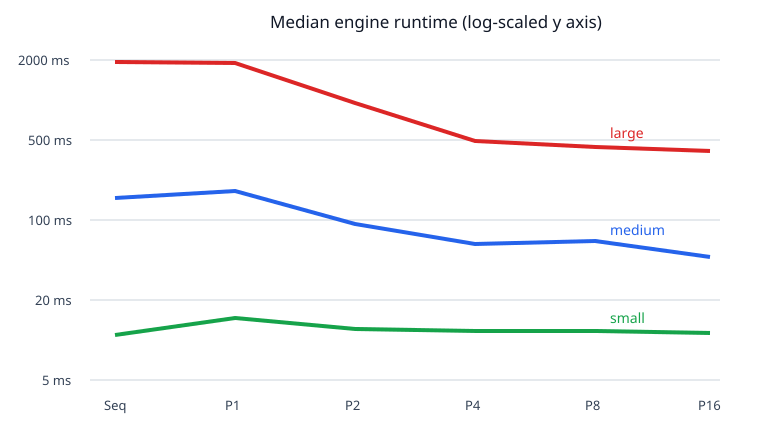

# Smart City Emergency Evacuation Simulator — Technical Report

## 1. Objective and scope

This project demonstrates deterministic data-parallel simulation using Java 21, JavaFX, and Maven. A seeded rectangular city contains blocked cells, exits, and uniquely positioned cars. Cars move one orthogonal cell per logical tick toward an exit. The application has exactly two modes: `SEQUENTIAL` and `PARALLEL`. They share all physics and conflict rules; only intent computation differs.

The deliverables are an interactive desktop application, a JavaFX-independent engine, a headless CSV benchmark, automated correctness/concurrency tests, measured runtime data, and this report. Real maps, networking, databases, distributed execution, machine learning, diagonal movement, and additional execution modes are deliberately excluded.

## 2. Architecture and algorithms

The layers are `ui`, shared `api`, `world`, `pathfinding`, `engine`, and `benchmark`. The engine has no JavaFX dependency. Seeded generation selects a connected traversable component large enough for all exits and cars, so every initial car is reachable. Immutable world states validate unique IDs/occupancy, bounds, blocked cells, exits, and sorted car order. SHA-256 fingerprints use topology, tick/event state, and sorted car state; timing and worker count are excluded.

Each tick applies an eligible deterministic road closure, captures one snapshot, orders cars by ID, computes one intent per car, resolves conflicts, validates, and atomically publishes a new state. A closure uses the first cell ID that is unoccupied, non-exit, and preserves exit reachability; otherwise it is deferred.

A* uses Manhattan distance to the closest exit and priority ordering `(f, h, cellId)`, with neighbors N/E/S/W. Equal-distance exits use the lowest exit cell ID. Planning ignores temporary car occupancy; the resolver applies congestion rules. A non-exit cell occupied at tick start cannot be entered, even if its occupant intends to move. This prevents swaps and cycles but can create realistic traffic gridlock.

The resolver is single-threaded and shared by both modes. Invalid moves stay. For multiple valid requests to one free road cell, accumulated wait count descending wins, then car ID ascending. A successful road move resets wait to zero; active losers/stayers increment once. Exit entrants are removed and exits have unlimited intake.

## 3. Parallel design and safety

Parallel mode owns a reusable fixed thread pool. It divides the ordered car list into at most `workerCount` stable contiguous partitions. Workers read the same immutable snapshot and write disjoint ranges of an indexed result array; there is no shared append and no simulation-time random generator. The coordinator joins all futures before invoking the common resolver, so no worker mutates live world state.

Failure atomicity follows from keeping event-adjusted state, snapshot, and intents local until resolution succeeds. Worker failure or interruption discards the whole candidate tick. API cancellation is visible without waiting for the engine monitor and interrupts current futures. Close is idempotent, rejects later ticks, awaits termination boundedly, and preserves interrupt state. Tests verify no pool-thread leak.

The UI owns a background session executor. It sends immutable snapshots/metrics to a dispatcher backed by `Platform.runLater`; canvas rendering asserts JavaFX-thread ownership. Start/pause/resume/stop/reset therefore do not run simulation work on the application thread.

## 4. Verification

The final suite contains unit and integration tests for API validation, immutable world generation, closure behavior, fingerprints, deterministic A*, resolver rules, lifecycle/failure atomicity, parallel partitioning, UI session/configuration, CLI parsing, and CSV correctness.

Cross-mode tests compare every tick's statistics, fingerprint, cars, and blocked set twice for three seeded configurations at worker counts 1, 2, 4, 8, and 16. A separate 32×24, 300-car case checks bounds, collisions, conservation, blocked cells, and exits. In-flight public `cancel()` and `close()` tests use a latched pathfinder, assert prompt interruption/no partial commit, and were repeated ten times without a race. The final command and result are recorded in the handoff rather than inferred here.

## 5. Benchmark method and results

Measurements ran headlessly on Windows 11, OpenJDK 21.0.11, Intel Family 6 Model 154. Each case used one warmup and three measured repetitions. Times below are measured medians; generation, CSV output, and JavaFX painting are excluded. All modes/worker counts within each scenario produced the same final fingerprint.

| Scenario | Grid / cars | Ticks | Sequential ms | P1 ms | P2 ms | P4 ms | P8 ms | P16 ms |
|---|---:|---:|---:|---:|---:|---:|---:|---:|
| Small | 24×18 / 80 | 54 | 9.318 | 15.138 | 10.671 | 10.106 | 10.068 | 9.716 |
| Medium | 40×30 / 250 | 199 | 139.516 | 153.929 | 86.588 | 62.399 | 64.510 | 50.433 |
| Large | 60×45 / 600 | 269 | 1920.926 | 1898.718 | 938.995 | 503.688 | 462.368 | 439.191 |

| Scenario | P1 speedup | P2 | P4 | P8 | P16 |
|---|---:|---:|---:|---:|---:|
| Small | 0.62× | 0.87× | 0.92× | 0.93× | 0.96× |
| Medium | 0.91× | 1.61× | 2.24× | 2.16× | 2.77× |
| Large | 1.01× | 2.05× | 3.81× | 4.15× | 4.37× |

The small workload is too short to amortize partition/future scheduling and is slower in parallel. Medium and large cases benefit, but scaling flattens after four to eight workers. Using Amdahl's relation `S(p)=1/(f+(1-f)/p)`, P16 implies an observed effective serial fraction near 0.32 for medium and 0.18 for large. These are end-to-end empirical estimates that include coordination and memory effects, not intrinsic constants. The tiny smoke dataset yields nonphysical inferred fractions because overhead violates ideal Amdahl assumptions; it is retained as correctness evidence, not a speedup claim.

## 6. Limitations and conclusion

Results come from one laptop, one JVM, three seeds/configurations, and three measured samples per case; there are no confidence intervals or hardware comparisons. A longer study should randomize more seeds, use more repetitions/forks, record CPU topology/load, and profile allocation/cache behavior. The JavaFX launch was smoke-tested, while the final handoff states whether the full interactive checklist was performed.

Within those limits, the implementation meets its central goal: sequential and parallel modes share identical rules and produce matching state at every tested tick. Parallel work is bounded and useful for larger scenarios, while the measurements honestly show that concurrency overhead can dominate small ones.
